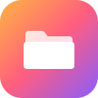

<div align="center">



# Files for Android

**The iPhone Files app, rebuilt natively for Android.**<br>
Browse every folder, USB drive and network share on your phone, with the calm, familiar feel of iOS.

[](https://github.com/shatheitguy/files-android/releases/latest)
[](https://shatheitguy.github.io/files-android/)
[](#-install)


[Features](#-features) · [Install](#-install) · [Build](#%EF%B8%8F-build-from-source) · [Author](#-author)

</div>

---

## ✨ Features

### 🗂️ Browse
- **Recents · Browse · Search** with a floating tab bar. Press it and slide your finger to switch tabs.
- **On My Phone**, SD card and **USB drives** (they only appear while plugged in), and **Recently Deleted** (30 days).
- **Favorites** and colored **Tags**. Every section folds away with a tap.
- **•••** menu: Edit, Connect to Server, Scan Documents, Settings and Check for Updates.

### 📁 Folders
- Icons or List view, sorted by Name, Kind, Date or Size, with hidden files on demand.
- **Aspect-ratio thumbnails** for photos, videos, PDFs and APKs.
- Long-press menu: Get Info, Rename, Compress / Uncompress (ZIP), Duplicate, Tags, Copy, Move, Share, Delete.
- **Select** mode with Select All. Swipe across files to select many at once.
- Copy and Move use an iOS-style sheet and a live **progress pill**.

### 🌐 Connect to Server
- **SMB 2/3** shares on a Windows PC, Mac or NAS: browse, open, download, upload, new folder, delete.

### 📄 Scan Documents
- Scan paper with the camera and save it as a PDF in `Documents/Scans`.

### 📱 Tablets
- An **iPad-style layout**: a sidebar with Recents, Search, Locations, Shared, Favorites and Tags beside your files.
- Your storage shows as **On My Tablet**, and Move / Copy opens as a centered sheet.

### 🤝 Works with Photos
- Pictures and videos open in **[Photos for Android](https://github.com/shatheitguy/photos-android)**, so you can swipe through the folder.
- **Save to Files** appears in every share sheet.
- Moves and deletes show up in Photos straight away.

### ⚙️ And more
- Glass menus and buttons, light / dark / automatic appearance.
- **Check for Updates** downloads and installs new versions right inside the app.

## 📥 Install
1. Download **`Files.apk`** from the [latest release](https://github.com/shatheitguy/files-android/releases/latest).
2. Open it on your phone and allow installing from this source if Android asks.
3. Open **Files**, tap **Continue** and turn on **Allow access to manage all files**.

> Requires **Android 10 or newer**. Scan Documents uses Google Play services.

## 🛠️ Build from source
You need JDK 17 and the Android SDK (platform 35).

```bash
git clone https://github.com/shatheitguy/files-android.git
cd files-android
echo "sdk.dir=/path/to/Android/Sdk" > local.properties
./gradlew assembleRelease
```

The APK is written to `app/build/outputs/apk/release/app-release.apk`.

<details>
<summary><b>Project layout</b></summary>

```
app/src/main/java/com/photos/files/
├── MainActivity.kt          Entry point, watches for USB drives
├── SaveActivity.kt          "Save to Files" from the share sheet
├── data/
│   ├── FileStore.kt         Listing, sorting, recents, trash, zip, volumes
│   ├── Smb.kt               SMB servers and shares
│   └── Thumbs.kt            Thumbnails for photos, videos, PDFs and APKs
└── ui/
    ├── Root.kt              Navigation, sheets, dialogs, progress pill
    ├── Screens.kt           Browse, Recents, Folder, Tags, Trash, Search
    ├── Collection.kt        File grid / list, selection, menus
    ├── SmbScreen.kt         Server browser
    ├── FilesTablet.kt       iPad-style sidebar and pane
    ├── FilesSettings.kt     Settings, ••• menu, document scanner
    ├── Updates.kt           In-app updates
    └── Theme.kt, IosIcons.kt, IosPopup.kt, SlidingTabs.kt, Tablet.kt
```
</details>

## 🔒 Privacy
No accounts, no ads, no analytics. Files only uses the internet to reach the servers you add and to check GitHub for new versions. Saved server passwords stay in the app's private storage.

## 👤 Author

<table>
  <tr>
    <td></td>
    <td>
      <b>Sharqan Ahamed</b><br>
      Designer and developer of Files and Photos for Android<br>
      <a href="https://github.com/shatheitguy">github.com/shatheitguy</a>
    </td>
  </tr>
</table>

If you enjoy the app, ⭐ the repo. It really helps!

---

<sub>Files for Android is an independent project and isn't affiliated with Apple or Google. The app icon is an original design.</sub>
